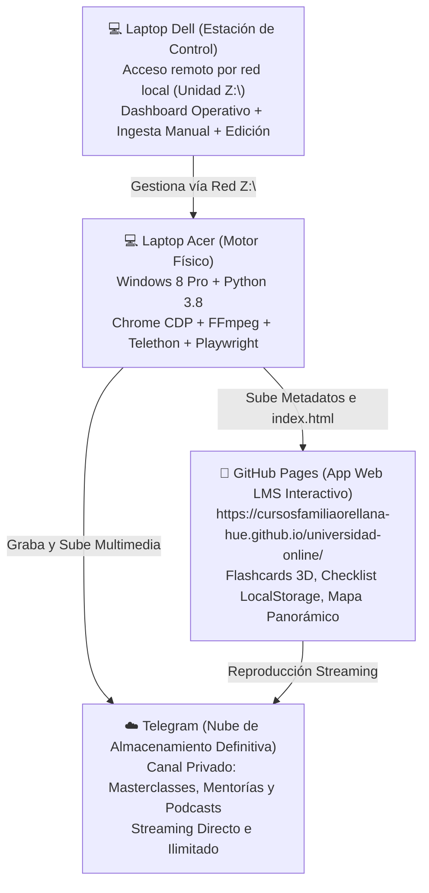

# 📖 MANUAL OFICIAL: Bot Universidad Online

> **Sistema Autónomo de Automatización, Scraping, Procesamiento Pedagógico con IA, LMS Interactivo y Despliegue Web**  
> *Versión del Sistema:* 4.0 Pro — Plataforma LMS Integral & Nube Definitiva  
> *Entorno Operativo:* Windows 8.1 Pro (Python 3.8) | Estación de Control Remoto en Red Local (`Z:\`)

---

## 1. 🌍 Visión General del Ecosistema

El sistema **Bot Universidad Online** es una infraestructura de ingeniería distribuida diseñada para funcionar 24/7 en piloto automático, dividida estratégicamente en cuatro capas colaborativas:



1. **💻 Laptop Acer (El Motor de Grabación y Procesamiento):**
   - Es la máquina física donde reside el repositorio compartido en red (`\\192.168.100.229\Bot_UniversidadOnline`).
   - Ejecuta los demonios autónomos: Google Chrome en puerto CDP 9222, FFmpeg para captura en segundo plano con bajo consumo de CPU, el Vigía de Telegram con barrido histórico y captura en vivo vía Telegram Web, y el motor de IA Gemini.
2. **💻 Laptop Dell (La Estación de Control y Monitoreo):**
   - Conectada a la Acer mediante la unidad de red mapeada `Z:\`.
   - Permite al usuario consultar el Dashboard Operativo en tiempo real, agendar clases, colocar archivos en las carpetas de Ingesta Manual, supervisar logs o pausar el Vigía sin intervenir físicamente en la pantalla de la Acer.
3. **☁️ Telegram (La Nube de Almacenamiento Definitiva):**
   - Funciona como el almacén multimedia definitivo, ilimitado y de alta disponibilidad.
   - Cada clase grabada o procesada manualmente se sube a tu canal privado y se enlaza directamente. Esto permite purgar los gigabytes de videos locales (`.mp4`, `.m4a`) de la Acer sin que las clases desaparezcan de la App Web.
4. **📱 GitHub Pages (La App Web LMS Interactiva en tu Celular):**
   - Despliegue web disponible en: **`https://cursosfamiliaorellana-hue.github.io/universidad-online/`**
   - Transforma tus grabaciones en una experiencia de aprendizaje completa: Flashcards interactivas con giro 3D, Checklist de estudio persistente con LocalStorage, Mapa Panorámico en 5 Fases, insignias de mentor/fecha y reproductor de audio/video directo.

---

## 2. 🚀 Los Archivos Ejecutables (.bat)

Todos los componentes del sistema se inician mediante scripts por lotes situados en la raíz de la carpeta. A continuación se detalla la función de cada uno:

| Archivo .bat | Función y Descripción Técnica |
| :--- | :--- |
| **`0_Instalar_Requisitos_Nueva_PC.bat`** | Script de aprovisionamiento inicial. Instala las librerías de Python (`requirements.txt`), descarga el motor Chromium para Playwright y verifica la presencia de `ffmpeg.exe`. Solo se ejecuta una vez al configurar una máquina nueva. |
| **`1_Abrir_Chrome_Hotmart.bat`** | **Imprescindible:** Inicia Google Chrome en el puerto de depuración remota `9222` usando un perfil independiente (`perfil_chrome`). Abre Hotmart y NotebookLM. Incluye banderas para evitar que Windows suspenda las pestañas en segundo plano. |
| **`2_Iniciar_Bot_Automatico.bat`** | **El Cerebro del Sistema (`main.py`):** Lanza el orquestador principal. Sincroniza horarios con Google Calendar, espera silenciosamente las clases, ejecuta la grabación en vivo sin robar foco, analiza con Gemini, sube a Telegram, actualiza GitHub Pages y purga los videos locales pesados. |
| **`3_Panel_Control_Web.bat`** | **Panel de Control Web Interactivo (`dashboard_web.py`):** Servidor Flask en `http://127.0.0.1:8000`. Permite ver la tabla en tiempo real de clases, streaming de logs, Hot-Cancel inmediato, Re-grabación (Safe Overwrite), forzar subida a Telegram y borrado físico seguro. |
| **`3_Reintentar_o_Repetir_Clase.bat`** | Lanza `gestor_regrabacion.py`. Permite seleccionar una clase fallida o repetida, aplicando Safe Overwrite para reactivarla en estado `PENDIENTE` sin borrar archivos previos hasta finalizar la nueva versión. |
| **`iniciar_sistema_silencioso.vbs`** | **Ejecutor Silencioso en Segundo Plano:** Lanza el orquestador automático de forma 100% invisible sin desplegar ventanas negras de consola en el escritorio. |
| **`detener_sistema.bat`** | **Frenado Seguro del Sistema:** Detiene limpiamente procesos en segundo plano (FFmpeg, instancias de Python y túneles locales) sin dejar procesos zombi. |
| **`backup_cerebro.bat`** | **Respaldo Anti-Desastres (Disaster Recovery):** Genera copias timestamped de `clases.db` y `config.json` en `_backups_db/` y realiza push automático a GitHub para resguardar la memoria del sistema. |
| **`4_Abrir_App_en_Celular_Wifi.bat`** | Inicia un servidor web local en el puerto `8080` (`python -m http.server 8080`) para acceder a la PWA a través de la misma red Wi-Fi doméstica. |
| **`4_Programador_Manual.bat`** | **Centro de Control Interactivo (`programador_manual.py`):** Interfaz CLI con Dashboard Operativo, Gestión Individual de Clases, Ingesta Manual, Hot-Cancel en tiempo real y administración de almacenamiento. |
| **`5_Abrir_App_en_Celular_Internet.bat`** | Muestra en pantalla el enlace público permanente de la App Web en GitHub Pages, ofrece instrucciones para instalar la PWA en el celular y abre el navegador web automáticamente. |
| **`5_Vigia_Mentorias.bat`** | **El Centinela Autónomo (`vigia_mentorias.py`):** Escucha en tiempo real canales privados y grupos de Telegram mediante Telethon. Incorpora barrido histórico al arrancar (Catch-Up), captura en vivo de llamadas vía Telegram Web y deduplicación inteligente cuando el mentor sube la grabación oficial. |
| **`6_Conectar_Con_GitHub.bat`** | Asistente de configuración Git. Aplica `safe.directory "*"` para evitar errores de permisos en Windows 8, configura el Personal Access Token (PAT) y vincula el repositorio remoto. |
| **`Login_Telegram.bat`** | Script interactivo para iniciar sesión en Telegram con Telethon una sola vez por SMS o código de app (`telegram_uploader.py --login`). Genera el archivo de sesión local. |
| **`Prueba_30_Segundos.bat`** | Prueba de integración rápida de 60 segundos (`prueba_30_segundos.py`). Graba la clase actual de Hotmart, procesa con Gemini y Telegram, validando que todo el ecosistema funcione correctamente. |

---

### ⏱️ Secuencia Recomendada para un Día Normal de Trabajo

Para encender la estación de trabajo y dejarla 100% operativa:

1. **Paso 1:** Enciende la laptop **Acer** y ejecuta **`1_Abrir_Chrome_Hotmart.bat`**. (Asegúrate de haber iniciado sesión en Hotmart).
2. **Paso 2:** Ejecuta **`2_Iniciar_Bot_Automatico.bat`**. Se abrirá la consola del orquestador `main.py`, que quedará vigilando en segundo plano con consumo mínimo de CPU (~1%).
3. **Paso 3:** Ejecuta **`5_Vigia_Mentorias.bat`**. Al abrirse, realizará de inmediato su **Barrido Histórico (Catch-Up)** para rescatar mensajes o links enviados mientras la PC estuvo apagada, y luego quedará escuchando en modo ultra-eficiente.
4. **Paso 4 (Opcional):** Desde tu laptop **Dell**, abre `Z:\4_Programador_Manual.bat` en cualquier momento para revisar el **Dashboard Operativo**, programar clases o volcar material en `Z:\Ingesta_Manual`.

---

## 3. 🎛️ El Centro de Control (`programador_manual.py`)

Al abrir **`4_Programador_Manual.bat`**, accederás a un menú interactivo robusto y enriquecido:

### D. 📊 Dashboard Operativo y Resumen General
Muestra una vista gerencial completa del estado del bot en tiempo real:
- **Métricas Globales:** Total de clases registradas, cantidad de Masterclasses, Mentorías y Grabaciones Independientes.
- **Distribución por Estado:** Clases `COMPLETADA`, `PENDIENTE`, `GRABANDO`, `FALLIDA` y `CANCELADO_MANUALMENTE`.
- **Sincronización en la Nube:** Cuántas clases tienen video en Telegram (`telegram_url`), cuántas tienen ficha de NotebookLM generada y cuántas disponen de audio-resumen activo.
- **Top Mentores:** Ranking de mentores con mayor cantidad de sesiones procesadas.

### 1. Programar Masterclass de Hotmart
Permite agendar manualmente una clase de Hotmart con título, fecha, hora y duración estimada en minutos. Si la hora seleccionada ya pasó hoy, se programa automáticamente para mañana.

### 2. Programar o Iniciar Mentoría (Zoom / Voz Telegram)
Agenda o inicia inmediatamente una mentoría de Zoom o llamada de Telegram asignándole su mentor correspondiente y su enlace o identificador.

### 3. 🛑 DETENER Grabación en Curso Ahora Mismo (Corte Limpio)
Genera el archivo señal `DETENER_GRABACION.txt`. El proceso grabador (`recorder.py`) detecta la señal en menos de 1 segundo, finaliza FFmpeg de forma ordenada preservando el video grabado hasta ese instante y libera Chrome.

### 4. 🛑 Cancelar Grabación o Pausar Vigía (Hot-Cancel en Tiempo Real)
Permite interrumpir tareas sin necesidad de reiniciar demonios:
- **Sub-opción 1 (Cancelar Clase Agendada):** Lista las clases `PENDIENTES` o en curso. Al ingresar el ID, cambia el estado a `CANCELADO_MANUALMENTE` y detiene el proceso si ya estaba grabando.
- **Sub-opción 2 (Pausar Vigía de Telegram por Hoy):** Escribe en `estado_vigia.json` una pausa temporal (por ejemplo hasta las 23:59:59). El Vigía ignorará llamadas y links para que puedas asistir desde otra PC sin interferencias.
- **Sub-opción 3 (Reanudar Vigía):** Elimina la pausa y reactiva la escucha inmediata.

### 5. 💾 Gestor de Almacenamiento y Borrado (Nube Definitiva)
- **Sub-opción A (Borrar SOLO videos locales pesados):** Elimina `.mp4`, `.m4a` y `.webm` de la carpeta `grabaciones/`, conservando fichas pedagógicas, quizzes y enlaces a Telegram. Informa los gigabytes exactos liberados.
- **Sub-opción B (Eliminar clase de la App Web - Ocultar temporalmente):** Alterna el estado entre `OCULTA` y `COMPLETADA`, republicando la web al instante sin borrar archivos.
- **Sub-opción C (Eliminación Nuclear de una Clase):** Con doble confirmación estricta (`SI` y `ELIMINAR`), borra la carpeta local, purga el registro de SQLite y actualiza la web.

### 6. 🎯 Gestión Individual de Clases
Accede a una clase específica mediante su ID para ejecutar operaciones quirúrgicas:
- **Cambio de Estado:** Cambiar entre `COMPLETADA`, `PENDIENTE`, `FALLIDA` u `OCULTA`.
- **Forzar Subida a Telegram:** Sube manualmente el video o audio local al canal privado de Telegram si la conexión falló anteriormente.
- **Forzar Procesamiento NotebookLM / Gemini:** Re-analiza la transcripción o video para regenerar la ficha didáctica, flashcards y quiz.
- **Borrado Seguro Granular (Safe-Purge):** Borra únicamente el archivo pesado local de esa clase en particular, manteniendo intacta la ficha y el botón de streaming en la web.

### 7. 📥 Ingesta Manual y Playbooks Externos
Módulo de importación masiva para digitalizar grabaciones previas, PDFs y notas externas.
- Escanea las 4 carpetas locales de `Z:\Ingesta_Manual` y `Z:\Playbooks_Externos`.
- Aplica el registro **"Memoria Viva"** en SQLite (`ingesta_manual_registro`) para garantizar que ningún archivo se procese dos veces.
- Extrae información pedagógica con IA Gemini, sintetiza Flashcards, sube a Telegram y regenera la App Web automáticamente.

### 8. ✏️ Modificar Nombre de Mentor ("Efecto Dominó")
Corrige el nombre de un mentor en una clase ya procesada y propaga el cambio en cascada: base de datos, posts de Telegram y App Web.

### 9. 👥 Añadir / Gestionar Mentores y Grupos Privados
Permite registrar nuevos mentores, asociarlos a sus canales de Telegram correspondientes y definir sus áreas de conocimiento.

### 10. 🔍 Auditar y Rescatar Procesos Incompletos
Diagnostica y reintenta procesos interrumpidos por cortes de energía o internet: tareas pendientes de NotebookLM, videos pendientes de subida a Telegram y sincronización de GitHub Pages.

### 11. 🌐 Regenerar y Publicar App Web en GitHub Pages Ahora
Ejecuta `route_builder.py` de forma forzada: actualiza los datos del LMS, genera las Flashcards y el Mapa Panorámico, y realiza el `git push` desatendido con sello anti-caché.

---

## 4. 📥 Guía de Ingesta Manual y Playbooks Externos

Si tienes clases grabadas con OBS, Zoom, podcasts descargados o guías en PDF que no fueron capturadas por el bot automático, puedes agregarlas al sistema en cuestión de segundos usando las 4 carpetas de ingesta:

```text
Z:├── Ingesta_Manual│   ├── Masterclasses\                 <-- Coloca videos (.mp4, .mkv, .webm) de clases formales
│   ├── Mentorias\                     <-- Coloca sesiones de mentoría (.mp4, .m4a, .mp3)
│   └── Grabaciones_Independientes\    <-- Entrevistas, talleres o llamadas sueltas
└── Playbooks_Externos\                 <-- PDFs, documentos .md, resúmenes o playbooks estratégicos
```

### 📋 Paso a Paso para Ingestar Material:
1. Copia tus archivos multimedia o documentos en la carpeta correspondiente dentro de `Z:\Ingesta_Manual\` o `Z:\Playbooks_Externos\`.
2. Puedes nombrarlos con claridad, por ejemplo:
   - `Z:\Ingesta_Manual\Masterclasses‚6-10-20_Copywriting_Persuasivo.mp4`
   - `Z:\Ingesta_Manual\Mentorias\Marcos_Mentalidad_Ganadora.m4a`
   - `Z:\Playbooks_Externos\Playbook_Lanzamientos_2026.pdf`
3. Abre **`4_Programador_Manual.bat`** y selecciona la **Opción 7** (*📥 Ingesta Manual y Playbooks Externos*).
4. El sistema te mostrará cuántos archivos nuevos detectó. Presiona `S` para confirmar el procesamiento.
5. **¿Qué hace el bot automáticamente?**
   - Registra el hash del archivo en la tabla de **Memoria Viva** (`ingesta_manual_registro`) para evitar duplicaciones futuras.
   - Envía el audio o documento a la API de **Gemini** para generar: Resumen ejecutivo, Infografía de pasos, Checklist de 15 minutos, Quiz de autoevaluación y **Flashcards interactivas**.
   - Sube el archivo multimedia a tu canal privado de **Telegram** generando su enlace de streaming directo.
   - Regenera la App Web y la publica en **GitHub Pages**.
   - Mueve el archivo procesado a la subcarpeta `procesados/` o te ofrece eliminarlo si deseas ahorrar disco.

---

## 5. 🦅 El Vigía de Telegram Avanzado (`vigia_mentorias.py`)

El Vigía de Telegram no solo escucha mensajes entrantes; cuenta con tres mecanismos de inteligencia autónoma:

### 1. Barrido Histórico (Catch-Up) al Iniciar
Cada vez que abres **`5_Vigia_Mentorias.bat`**:
- Consulta la tabla `configuracion_vigia` en SQLite para conocer la fecha y hora exacta de la última desconexión.
- Si la PC estuvo apagada o sin internet durante horas o días, el Vigía ejecuta un barrido con `client.iter_messages` revisando todos los canales y grupos de mentores registrados.
- Procesa cualquier link de Zoom, cápsula de valor o aviso emitido durante la ausencia, evitando que te pierdas información valiosa.
- Actualiza la marca temporal de última ejecución para el siguiente reinicio.

### 2. Captura en Vivo de Llamadas vía Telegram Web
Cuando un mentor o el grupo "Universidad Online" inicia una llamada de voz o video chat en vivo:
- Si Telethon no puede capturar el stream nativo, el Vigía activa el módulo de grabación de **Playwright** (`recorder.grabar_llamada_telegram_web`).
- Playwright conecta con Google Chrome mediante CDP (`localhost:9222`), abre una pestaña aislada en `web.telegram.org` e ingresa al grupo de la llamada.
- **Seguridad Garantizada:** Bloquea por completo el micrófono y la cámara para que el bot entre en modo oyente 100% silencioso.
- Inicia la captura de audio/pantalla con FFmpeg y vigila constantemente el DOM de Telegram Web.
- Cuando la llamada finaliza (o la UI muestra "Llamada finalizada"), detiene la grabación limpiamente, envía el audio a NotebookLM/Gemini y publica la sesión.

### 3. Deduplicación Inteligente y Sustitución Oficial
- Es común que un mentor primero transmita una llamada en vivo y, horas después, suba al grupo el archivo de video oficial en alta calidad.
- Si el Vigía detecta que el mentor subió la grabación oficial correspondiente a una sesión que ya había sido grabada en vivo de forma preliminar:
  - **No duplica la clase:** Localiza el registro previo en SQLite mediante `buscar_mentoria_por_mentor_y_fecha`.
  - Reemplaza el audio preliminar por el archivo oficial de alta fidelidad.
  - Sube la versión definitiva a Telegram, re-analiza con Gemini y actualiza la App Web sin generar clases duplicadas.

---

## 6. 📱 Plataforma LMS Interactiva y App Web (GitHub Pages)

La App Web alojada en **`https://cursosfamiliaorellana-hue.github.io/universidad-online/`** ha evolucionado de un catálogo estático a una plataforma de aprendizaje activo:

### 🎴 Flashcards Interactivas con Giro 3D
- Cada clase, mentoría o cápsula cuenta con tarjetas de memoria para repasar conceptos críticos.
- Al hacer clic o tocar una flashcard, la tarjeta realiza una animación de giro 3D (flip card) revelando la respuesta estratégica.
- Incluye indicadores de dificultad (*Básica*, *Intermedia*, *Avanzada*) para optimizar tus sesiones de estudio.

### ✅ Checklist de Estudio con Persistencia en LocalStorage
- En la cabecera de cada tarjeta de clase encontrarás un botón interactivo: **`Marcar como Estudiada`**.
- Al activarlo, el estado se guarda inmediatamente en el almacenamiento local de tu navegador (`localStorage`), de modo que tus progresos se mantienen intactos aunque recargues la página o cierres el navegador.
- La barra superior de progreso te muestra el porcentaje dinámico de clases completadas y el número exacto de sesiones dominadas.

### 🗺️ Mapa Panorámico de Estudio (Roadmap en 5 Fases)
El aprendizaje se organiza en una ruta secuencial y estructurada en 5 fases progresivas:
1. **Fase 1: Fundamentos y Estrategia Base**
2. **Fase 2: Creación y Oferta Irresistible**
3. **Fase 3: Tráfico y Adquisición de Prospectos**
4. **Fase 4: Ventas, Cierres y Conversión**
5. **Fase 5: Escalamiento y Automatización**

Al hacer clic en cualquier fase del mapa, la plataforma filtra instantáneamente las clases correspondientes.

### ⭐ Insignia de Clase Clave (Elegancia Visual)
- Se ha eliminado la etiqueta de texto explícita de Pareto.
- Las clases con mayor potencial e impacto práctico se destacan elegantemente con un borde dorado y la insignia **`⭐ Clase Clave`**.

### 🎧 Acceso Universal a Podcasts y Audio-Resúmenes
- El 100% de las clases cuentan con reproductor de audio integrado o indicador de encolamiento si el audio está en procesamiento.
- Las mentorías muestran insignias distintivas con el nombre del Mentor y la fecha de la sesión para su rápida identificación.

---

## 7. 🛠️ Guías Paso a Paso (Casos de Uso Común)

---

### ¿Cómo agendar una Masterclass de Hotmart para que se grabe sola mañana?

1. Abre **`4_Programador_Manual.bat`** (desde la laptop Acer o desde la Dell vía `Z:\`).
2. Elige la **Opción 1** (*Programar Masterclass de Hotmart*).
3. Pega el enlace directo del producto en Hotmart, o escribe el nombre exacto de la clase.
4. Si la clase está dividida en varias partes en la plataforma, responde `S` a la pregunta de partes e indica el número de parte.
5. Cuando solicite el horario de inicio, escribe la hora en formato 24 horas (ej. `09:00` o `15:30`). Si la hora indicada ya pasó el día de hoy, el bot la agendará automáticamente para mañana.
6. Ingresa la duración estimada en minutos (ej. 2 horas = `120`).
7. El sistema confirmará: `✅ Agendada: [Título] para las [Hora] ([Min] min)`.
8. Si tienes **`2_Iniciar_Bot_Automatico.bat`** en ejecución, no tienes que hacer nada más. El bot entrará 5 minutos antes, esperará silenciosamente al profesor, grabará, extraerá el análisis pedagógico, lo subirá a Telegram y actualizará tu App Web.

---

### ¿Qué hacer si hay un error y necesito detener todo de emergencia?

El sistema cuenta con dos mecanismos de seguridad para detención inmediata:

#### Método A: Desde la consola del Orquestador (`main.py`):
1. Ve a la ventana negra que tiene el título de `main.py` y presiona la combinación de teclas **`Ctrl + C`**.
2. El bot activará el **Escudo de Interrupción Segura** y preguntará:
   ```text
   ⚠️ [SEGURIDAD BOT] ¿Seguro que quieres detener el bot de emergencia? (S/N):
   ```
3. Si fue un error o un teclado accidental, presiona `N` y el bot seguirá trabajando sin interrupción.
4. Si deseas detenerlo por completo, presiona `S` y `Enter`. El sistema liberará las pestañas y cerrará los procesos de forma limpia.

#### Método B: Frenado en Seco sin tocar la consola (`programador_manual.py`):
1. Abre **`4_Programador_Manual.bat`**.
2. Selecciona la **Opción 3** (*🛑 DETENER grabación en curso ahora mismo*).
3. El sistema creará la bandera de freno `DETENER_GRABACION.txt`.
4. El grabador capturará la orden en el siguiente segundo, detendrá FFmpeg cerrando el archivo de video de forma segura y liberará Chrome.

---

### ¿Cómo liberar espacio en el disco duro sin borrar las clases de la Web?

Gracias a la arquitectura de **Nube Definitiva**, los videos residen en tu canal de Telegram:

1. Abre **`4_Programador_Manual.bat`**.
2. Selecciona la **Opción 5** (*💾 Gestor de Almacenamiento y Borrado*).
3. Selecciona la **Sub-opción A** (*🧹 Borrar SOLO videos locales pesados*).
4. El sistema te pedirá confirmación: presiona `S`.
5. El bot escaneará todas las carpetas, eliminará los archivos pesados (`.mp4`, `.m4a`, `.webm`) y te reportará el espacio exacto recuperado (ej. `💾 Espacio en disco recuperado: 14500.5 MB (14.16 GB)`).
6. **Resultado:** Tu disco duro queda libre, y al abrir la App Web en tu celular, todas las clases siguen apareciendo con sus infografías, flashcards, quizzes y el botón `🎬 Ver en Telegram` para reproducir el video en streaming.

---

### ¿Cómo cancelar temporalmente al Vigía si quiero entrar a la reunión de Zoom desde mi otra PC?

Si vas a participar activamente en una reunión y no quieres que el bot de la Acer abra Zoom ni grabe tu pantalla:

1. Abre **`4_Programador_Manual.bat`**.
2. Selecciona la **Opción 4** (*🛑 Cancelar Grabación o Pausar Vigía*).
3. Selecciona la **Sub-opción 2** (*Pausar / Silenciar al Vigía de Telegram por hoy*).
4. El sistema activará el silenciador:
   ```text
   ⏸️ ¡VIGÍA DE TELEGRAM SILENCIADO CON ÉXITO!
   El Vigía ignorará links de Zoom, llamadas de voz y mensajes hasta: YYYY-MM-DD 23:59:59.
   ```
5. Ahora puedes ingresar libremente a Zoom o Telegram desde tu laptop Dell; el bot de la Acer permanecerá inerte.
6. Cuando termine tu día o desees reactivarlo antes de la medianoche, vuelve a la **Opción 4** y elige la **Sub-opción 3** (*▶️ Reanudar Vigía de Telegram AHORA*).

---


---

## 6. 🛡️ Protocolo de Recuperación ante Desastres (Disaster Recovery)

El sistema implementa una arquitectura de **Resiliencia Total y Desacoplamiento de Datos**:
- **El Almacén Multimedia:** Los videos residen en los canales privados de Telegram (almacenamiento ilimitado y gratuito de alta velocidad con Telethon y `cryptg`).
- **El Cerebro del Sistema (`clases.db`):** Es una base de datos SQLite ultraligera que almacena toda la metadata histórica, URLs de streaming en Telegram, cuadernos de NotebookLM, clasificaciones Pareto 80/20, checklists y flashcards.
- **La Interfaz Web Serverless (`index.html` + `data.json` / `database.json`):** Desplegada en GitHub Pages, hidrata la App Web de forma asíncrona sin consumir CPU de tu equipo.

### 💾 ¿Cómo se realiza el respaldo automático de la memoria?

1. Ejecuta **`backup_cerebro.bat`** cuando desees generar un punto de restauración seguro o antes de formatear/cambiar de equipo.
2. El script genera una copia de seguridad timestamped en la carpeta local `_backups_db/` (ej. `_backups_db\clases_backup_20261020_174328.db`).
3. Si Git está configurado, añade automáticamente `clases.db`, `data.json` y `database.json`, crea un commit con marca de tiempo y realiza un `git push origin main` hacia tu repositorio privado de GitHub.
4. **Protección de Datos:** El archivo `.gitignore` ha sido configurado para incluir `!clases.db` mientras excluye estrictamente todos los archivos multimedia pesados (`*.mp4`, `*.webm`, `grabaciones/`), sesiones y perfiles temporales.

---

### 💻 Procedimiento Paso a Paso para Restaurar en una Laptop Nueva (Desde Cero)

Si tu laptop actual sufre un daño irreparable, es robada o cambias a un equipo nuevo, sigue estos pasos para restaurar el 100% del sistema en menos de 10 minutos sin perder ninguna clase:

1. **Paso 1: Clonar el repositorio desde GitHub:**
   En la nueva computadora, abre la terminal o consola y clona tu repositorio:
   ```bash
   git clone https://github.com/cursosfamiliaorellana-hue/universidad-online.git
   cd universidad-online
   ```
   *(Como `clases.db` está incluido en el control de versiones, todo tu historial, IDs y enlaces de Telegram vendrán intactos).*

2. **Paso 2: Instalación de Requisitos:**
   Ejecuta con doble clic el archivo:
   ```text
   0_Instalar_Requisitos_Nueva_PC.bat
   ```
   Este archivo instalará las librerías necesarias de Python (`requirements.txt`), configurará Playwright con Chromium y verificará las herramientas auxiliares.

3. **Paso 3: Restaurar Credenciales Privadas:**
   Crea o pega tu archivo `config.json` en la raíz del proyecto con tus tokens y credenciales (puedes tomar como referencia el backup generado en `_backups_db/` o tus notas seguras).

4. **Paso 4: Iniciar Sesión en Telegram y Chrome:**
   - Ejecuta `1_Abrir_Chrome_Hotmart.bat` e inicia sesión en Hotmart y NotebookLM.
   - Ejecuta `Login_Telegram.bat` una sola vez para autenticar tu cuenta de Telegram y generar el archivo de sesión.

5. **Paso 5: Lanzar el Panel de Control Web:**
   Ejecuta:
   ```text
   3_Panel_Control_Web.bat
   ```
   Se abrirá de inmediato tu navegador en **`http://127.0.0.1:8000`**. Verás todas tus clases registradas con su estado, enlaces de streaming de Telegram e infografías disponibles de inmediato.

6. **¡Sistema 100% Recuperado!**
   El bot continuará grabando nuevas clases, sincronizándose con Google Calendar y subiendo a Telegram sin duplicaciones ni pérdida de datos.

> **Mantenimiento y Soporte:**  
> Documento técnico oficial generado y mantenido por el sistema de ingeniería de **Bot Universidad Online**.  
> Todos los derechos reservados © 2026.
